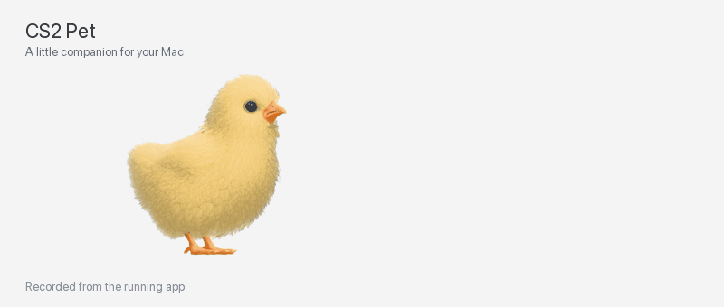

# CS2 Pet

A macOS desktop companion: a chick or chicken from Counter-Strike 2 that walks along your Dock, rests, preens and responds to clicks.



*A short recording of the running app. A neutral background was added for clarity.*

## Features

- Four models: chick, Catalana, Silkie and Polish.
- 104 original animation clips, including walking, running, sleeping, reactions, tricks and photo poses.
- Drag to reposition, Dock placement, size controls and pause.
- Quiet game sounds with a mute toggle.
- Soft environment lighting, recovered material maps and antialiasing for fluffy feathers.
- Runs offline without Steam after local asset preparation and building.

Right-click the bird or use the 🐥/🐔 menu bar icon to access the controls.

## Why game assets are not included

**Valve models, textures, sounds and animation data are not distributed in this repository.** They belong to Valve and/or its licensors; CS2 being free to play does not make its assets freely reusable. Valve's [Video Policy](https://store.steampowered.com/video_policy) explicitly discourages distributing extracted game assets separately. Use of game content is also governed by the [Steam Subscriber Agreement, §2](https://store.steampowered.com/agreement/).

This repository contains the app's source code, asset preparation tools and a demo GIF. It does not include game files or a prebuilt app containing them. This is an unofficial fan project and is not affiliated with Valve.

**You can prepare assets yourself from your own CS2 installation**, provided you have the necessary rights for that use. The script reads local VPK files; it does not download the game or upload assets to GitHub. Preparing assets locally does not grant permission to redistribute the resulting files.

## Build

Requires macOS 13+, Apple Silicon, Command Line Tools, Node.js 18+ and Python 3. Initial asset preparation also requires .NET 10, VRF 20.1 with the included patch, Pillow, NumPy and ffmpeg.

```sh
git clone https://github.com/cayde-6/CS2DesktopPet.git
cd CS2DesktopPet
npm ci
```

Follow the [asset preparation guide](docs/ASSET_PREPARATION.md). You will need the `game/csgo` directory from your own CS2 installation, including `pak01_dir.vpk` and its numbered VPK archives. You can copy these files from Windows or Linux.

Once the assets are ready:

```sh
npm run check:assets
npm test
./build.sh
open "build/CS2 Pet.app"
```

You do not need to extract assets again for subsequent builds. The resulting `.app` includes your local resources and runs without Node.js, Python, .NET or the game running. Everything in `Assets/`, except its explanatory README, is excluded from Git.

## Validation and architecture

`npm test` checks all four model skeletons, animation bindings, foot planting, rest sequences and Dock placement. These checks require locally prepared assets.

The native shell uses AppKit and WKWebView; rendering uses Three.js. See the [action audit](docs/ACTION_AUDIT.md) for verified menu behaviour and the [technical notes](docs/TECHNICAL_NOTES.md) for extraction, materials, antialiasing and diagnostic flags, and the [third-party notices](docs/THIRD_PARTY_NOTICES.md).
